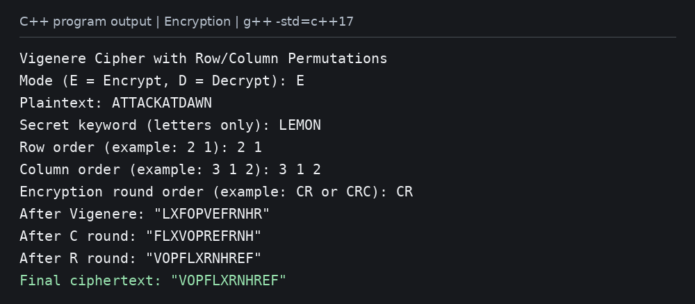
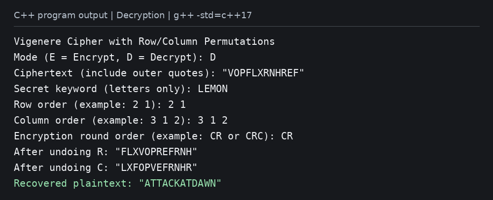

# Homework 2 - Vigenere Cipher

**Name:** Charbel Chidiac  
**Course:** CSC316

A C++ console program that encrypts and decrypts a word or phrase using the
Vigenere cipher followed by one or more row/column permutation rounds.

## Run

In Visual Studio, create a C++ **Console App**, replace its generated source
with `main.cpp`, and press **Ctrl+F5**.

Or compile with a C++17 compiler:

```sh
g++ -std=c++17 main.cpp -o vigenere
./vigenere
```

On Windows, run `vigenere.exe` instead of `./vigenere`.

1. Select `E` to encrypt or `D` to decrypt.
2. Enter the plaintext, or paste the final ciphertext **including its outer quotes**.
3. Enter a keyword containing English letters only.
4. Enter the row and column orders. For example, `2 1` and `3 1 2` define a
   2-row, 3-column grid. Each order must contain every position exactly once.
5. Enter the encryption round sequence: `C` means columns and `R` means rows.
   For example, `CR` applies columns then rows; `CRC` adds another column round.

Use the **same keyword, orders, and encryption round sequence** for decryption.

## How it works

Vigenere uses A=0 through Z=25. Encryption adds the repeated keyword shift
modulo 26; decryption subtracts it. Letter case is preserved. Spaces, numbers,
and punctuation do not advance the keyword and are unchanged by substitution.

Each permutation round splits the current text into blocks matching the grid
size and fills each grid from left to right, top to bottom. A column round
reorders columns; a row round reorders rows. The grid is then read left to
right, top to bottom. For an incomplete final block, missing cells are skipped;
no padding characters are added. All existing characters, including spaces and
punctuation, participate in permutations.

Decryption applies the inverse permutations in reverse round order, placing
each character back at its original position, then reverses Vigenere.
The output uses C++ `quoted()` formatting to preserve leading/trailing spaces,
quotation marks, and backslashes during copy-paste. The outer quotes are a
formatting wrapper, not part of the encrypted message. Input is one line.

## Example tests

All examples use keyword `LEMON`, row order `2 1`, and column order `3 1 2`.
Quotes below show the exact boundaries of each string.

| Plaintext | Rounds | Final ciphertext | Recovered plaintext |
|---|---|---|---|
| `"ATTACKATDAWN"` | `CR` | `"VOPFLXRNHREF"` | `"ATTACKATDAWN"` |
| `"Attack at dawn!"` | `CRC` | `"pvoxfLrn ef r!h"` | `"Attack at dawn!"` |
| `"  Meet at 9:30!  "` | `RC` | `"hiqX  : 9e n3  0!"` | `"  Meet at 9:30!  "` |

For the first example, the intermediate results are:

```text
Vigenere:    LXFOPVEFRNHR
Columns:    FLXVOPREFRNH
Rows:       VOPFLXRNHREF
```

## Output images

The images below display actual console transcripts captured from the compiled
C++ program. The first run encrypts; the second pastes its ciphertext back
into decryption and recovers the original text.




